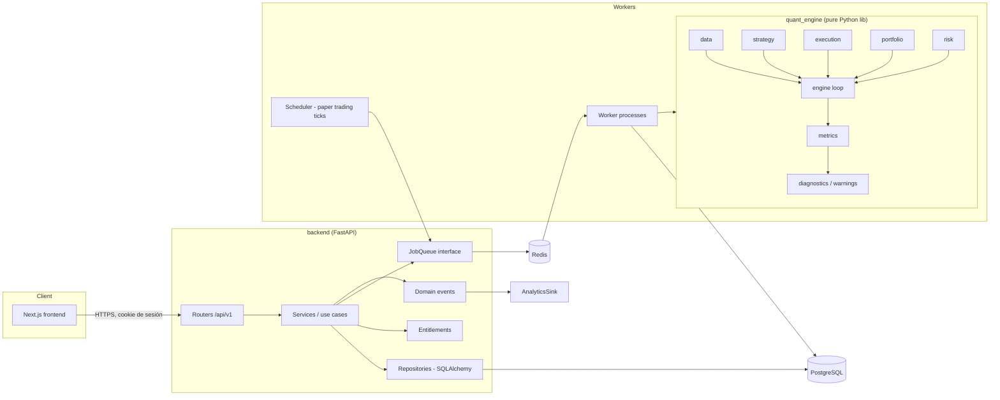
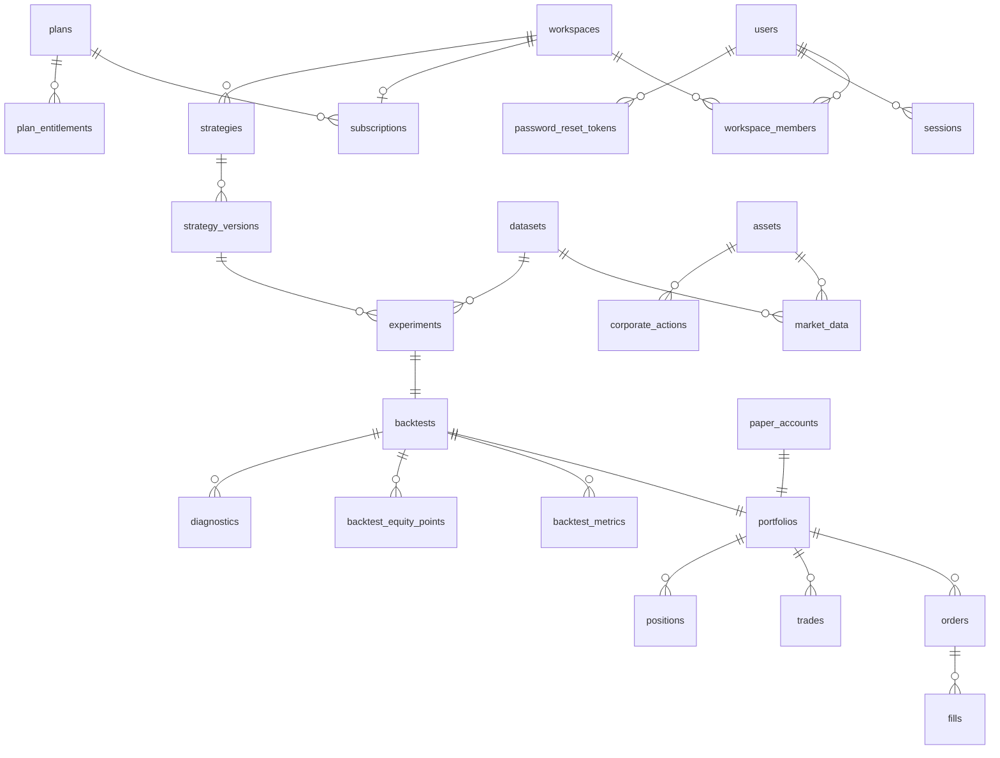

# QuantLab — Arquitectura

> Estado: **propuesta (Fase 0)**. Este documento define la arquitectura objetivo del MVP y los
> puntos de extensión para después del MVP. Las decisiones difíciles de revertir están
> registradas como ADRs en [`docs/adr/`](docs/adr/). Los riesgos y el plan por fases están en
> [`docs/RISKS.md`](docs/RISKS.md) y [`docs/IMPLEMENTATION_PLAN.md`](docs/IMPLEMENTATION_PLAN.md).
> Las definiciones matemáticas de las métricas están en [`docs/METRICS.md`](docs/METRICS.md).

Prioridad de ingeniería, en este orden: **CORRECTNESS > SECURITY > MAINTAINABILITY > PERFORMANCE > FEATURES**.

---

## 1. Análisis de requisitos

### 1.1 Qué es el producto

QuantLab es infraestructura cuantitativa como servicio: el usuario define una estrategia, la
ejecuta contra datos históricos (backtest) o contra datos nuevos sin dinero real (paper trading),
guarda cada ejecución como un experimento reproducible y analiza/compara resultados.

### 1.2 Actores

| Actor | Necesidad principal |
|---|---|
| Trader cuantitativo individual (FREE/PRO) | Iterar rápido sobre estrategias sin montar infraestructura |
| Equipo (TEAM) | Compartir estrategias y experimentos dentro de un workspace |
| Operador de la plataforma | Cargar datasets, vigilar jobs, gestionar planes |

### 1.3 Alcance del MVP

Dentro: auth + perfil, dashboard, strategy builder (declarativo), motor de backtesting
event-driven, métricas, página de resultados, comparación, experiment tracking, paper trading,
gestión de datos históricos, módulo de riesgo básico, avisos anti-sesgo, eventos de analytics,
arquitectura de planes (sin pagos).

Fuera (detrás de interfaces, documentado cómo se incorpora):

| Funcionalidad | Interfaz que la habilita | Por qué no en el MVP |
|---|---|---|
| Live trading | `Broker` / `ExecutionVenue` con modo `LIVE` | Riesgo financiero y regulatorio; requiere auditoría, kill-switch, reconciliación |
| Código Python de usuario | `StrategyRuntime` (sandbox en proceso aislado) | Requiere sandbox real (gVisor/Firecracker); no se hace a medias |
| Proveedores de datos externos | `MarketDataProvider` | Licencias y costes; la interfaz queda lista |
| VaR, CVaR, stress, correlaciones | `RiskModel` | Necesitan multi-activo y series largas para ser fiables |
| Optimización de parámetros | `ParameterSweep` job + contador de ensayos | Sin control de sobreajuste (deflated Sharpe) sería engañoso |
| Pagos | `BillingProvider` (Stripe) | Explícitamente excluido |
| Multi-activo / carteras | El motor ya es multi-símbolo; el builder no | UX y riesgo de concentración primero |
| Intradía | `Timeframe` + calendarios | Volumen de datos y calidad de timestamps |

### 1.4 Requisitos no funcionales

- **Corrección numérica verificable**: cada métrica tiene definición, test con valores calculados a
  mano y tratamiento explícito de casos límite. Una métrica que no puede calcularse devuelve
  `None` + motivo, nunca un número inventado (ver `docs/METRICS.md`).
- **Sin look-ahead por construcción**: la estrategia sólo puede leer datos con
  `available_at <= t` y sus órdenes sólo se ejecutan en barras posteriores (ver §5.3).
- **Reproducibilidad**: un experimento se puede volver a ejecutar y obtener el mismo resultado
  byte a byte (mismo spec inmutable, mismo snapshot de datos con hash, misma versión del motor).
- **Separación estricta** entre datos reales / sintéticos y entre backtest / paper / live, a nivel
  de tipos, de base de datos y de UI (§7).
- **Aislamiento**: ningún código arbitrario de usuario se ejecuta en el MVP; trabajos largos en
  workers, nunca en el proceso HTTP.
- **Multi-tenant desde el día 1**: todo recurso pertenece a un *workspace* (§10.1).

### 1.5 Ambigüedades y supuestos

| Tema | Supuesto adoptado | Reversible |
|---|---|---|
| Clase de activo MVP | Acciones/ETFs de EE. UU., barras diarias (`1D`). El modelo soporta cripto (calendario 24/7) sin cambios de esquema | Sí |
| Fuente de datos real | No hay aún. Se entrega `HistoricalCSVProvider` con proveniencia obligatoria y un dataset **sintético** etiquetado para tests/dev. Ver pregunta abierta en `docs/RISKS.md` | Sí |
| "Paper trading recibe nuevos datos" | Requiere un feed de datos reales incrementales. Sin proveedor, el feed disponible es *replay* y se etiqueta como **SIMULATED FEED** | Sí |
| Moneda | Una moneda por portfolio (USD en MVP). Sin FX | Medio |
| Apalancamiento | Cuenta cash, leverage máximo 1.0, sólo largos | Sí (la interfaz de riesgo ya lo valida) |
| Fracciones de acción | Desactivadas por defecto (cantidad entera), configurable por experimento | Sí |

---

## 2. Vista general



Reglas de dependencia (verificadas en CI con `import-linter`):

```
frontend  ──HTTP──▶ backend ──▶ quant_engine
workers   ─────────▶ backend (servicios/repos) ──▶ quant_engine
quant_engine ──▶ numpy, pandas, scipy   (NUNCA backend, SQLAlchemy, FastAPI, Redis)
```

`quant_engine` es una librería pura y determinista: entra un `BacktestConfig` + datos, sale un
`BacktestResult`. No sabe de usuarios, HTTP ni base de datos. Esto permite testearla aislada,
ejecutarla en un sandbox en el futuro y reutilizarla idéntica en backtest y paper trading.

---

## 3. Estructura del monorepo

```
.
├── frontend/                 Next.js (App Router) + TypeScript strict + Tailwind
│   ├── src/app/              rutas: (auth)/, (app)/dashboard, strategies, backtests, compare, paper, data, settings
│   ├── src/components/       UI reutilizable (ui/ primitivas, charts/, tables/, finance/)
│   ├── src/lib/api/          cliente generado desde OpenAPI (openapi-typescript) + fetch wrapper
│   └── src/lib/format/       formateo numérico/fechas (una sola fuente de verdad)
├── backend/
│   ├── src/quantlab_api/
│   │   ├── main.py           app factory, middlewares
│   │   ├── core/             config (pydantic-settings), seguridad, logging, errores
│   │   ├── db/               engine, session, base, modelos SQLAlchemy
│   │   ├── modules/          un paquete por bounded context (ver §4)
│   │   │   └── <module>/     router.py · schemas.py · service.py · repository.py
│   │   └── events/           bus de eventos de dominio + sinks (analytics)
│   ├── migrations/           Alembic
│   └── tests/                unit + integración (Postgres real)
├── quant_engine/
│   ├── src/quant_engine/
│   │   ├── data/             MarketDataProvider, providers, validación, calendarios, corporate actions
│   │   ├── strategy/         Strategy protocol, spec declarativo, compilador, indicadores
│   │   ├── execution/        órdenes, fill models, slippage, comisiones, brokers simulados
│   │   ├── portfolio/        ledger (Decimal), posiciones, valoración
│   │   ├── risk/             reglas pre-trade, sizing, métricas de riesgo, interfaces VaR/CVaR
│   │   ├── metrics/          funciones puras de métricas (docs/METRICS.md)
│   │   ├── diagnostics/      avisos anti-sesgo y calidad de datos
│   │   ├── engine/           bucle event-driven, BacktestRunner, PaperSession
│   │   └── types.py          tipos de dominio compartidos (inmutables)
│   └── tests/                unit, property-based (Hypothesis), golden
├── workers/
│   └── src/quantlab_workers/ actores (backtest, paper tick, data import), scheduler
├── data/
│   ├── fixtures/             datasets pequeños para tests (sintéticos, etiquetados)
│   └── README.md             procedencia y licencia de cada dataset
├── tests/
│   ├── e2e/                  Playwright (flujo Register → Strategy → Backtest → Results)
│   └── integration/          pruebas cruzadas backend + worker + engine
├── infra/
│   ├── docker/               Dockerfiles (non-root, multi-stage)
│   ├── compose/              docker-compose.yml (+ override dev)
│   └── ci/                   scripts auxiliares de CI
├── scripts/                  dev.sh, seed, generación de cliente API
├── docs/                     ADRs, métricas, riesgos, plan
└── Makefile                  install · dev · test · lint · build · migrate · seed
```

Tooling: Python gestionado con **uv** (workspace con `quant_engine`, `backend`, `workers`),
Node con **pnpm**. Python ≥ 3.11 (imágenes Docker con 3.12).

---

## 4. Backend: bounded contexts

Cada módulo expone `router` (HTTP fino: validación + auth + delegación), `service` (casos de uso,
transacciones), `repository` (acceso a datos). **Los routers nunca contienen lógica cuantitativa**;
los servicios llaman al motor mediante adaptadores, normalmente vía un job.

| Módulo | Responsabilidad |
|---|---|
| `identity` | registro, login, logout, sesiones, reset de contraseña, perfil |
| `workspaces` | workspaces personales y de equipo, membresías, roles |
| `billing` | planes, suscripciones, entitlements, contadores de uso (sin pagos) |
| `market_data` | activos, datasets, importación, consulta de barras, corporate actions |
| `strategies` | estrategias, versiones inmutables, validación del spec |
| `backtests` | encolar, estado, resultados, métricas, trades, curva de equity |
| `experiments` | registro reproducible, re-ejecución, comparación |
| `paper_trading` | cuentas paper, sesiones, órdenes/trades/posiciones paper |
| `analytics` | eventos de producto (no invasivos) |
| `jobs` | abstracción de cola, estado de jobs, cancelación |

Comunicación backend → motor: a través de un **adaptador** (`EngineGateway`) que traduce modelos de
BD a tipos del motor (`BacktestConfig`, `StrategySpec`, `BarSeries`) y resultados de vuelta. Es la
única pieza del backend que importa `quant_engine`.

---

## 5. Quant Engine

### 5.1 Capas

```
MarketData ──▶ Strategy ──▶ (OrderIntent) ──▶ Risk (pre-trade) ──▶ Execution model ──▶ Fill
                    ▲                                                                   │
                    └──────────── Portfolio (ledger) ◀──────────────────────────────────┘
                                         │
                                         ▼
                              Metrics ──▶ Diagnostics (warnings)
```

| Capa | Contrato | MVP |
|---|---|---|
| `data` | `MarketDataProvider`, `BarSeries`, `CorporateAction`, `TradingCalendar` | CSV, Mock |
| `strategy` | `Strategy` protocol; `StrategySpec` declarativo compilado a `Strategy` | SMA/EMA/RSI cross, umbrales |
| `execution` | `FillModel`, `SlippageModel`, `CommissionModel`, `Broker` | next-bar-open, % slippage, % comisión (+ mínimo) |
| `portfolio` | `Ledger` (Decimal), `Position`, `PortfolioSnapshot` | cash + largos |
| `risk` | `PreTradeRule`, `PositionSizer`, `RiskModel` | leverage ≤ 1, sin cortos, sizing % equity, concentración |
| `metrics` | funciones puras `(series) -> MetricResult` | las 14 métricas del MVP |
| `diagnostics` | `Diagnostic(code, severity, message, context)` | ver §5.7 |

### 5.2 Strategy API

Dos niveles, ambos producen el mismo objeto `Strategy` que consume el motor:

**a) Spec declarativo (lo que crea el usuario en el MVP).** JSON validado con Pydantic (en backend)
y con un validador propio en el motor. No es código: es datos. No hay `eval`, ni expresiones
libres; sólo nodos de un catálogo cerrado (indicadores, comparadores, operadores lógicos).

```json
{
  "schema_version": 1,
  "universe": [{"symbol": "SPY"}],
  "timeframe": "1D",
  "indicators": {
    "fast": {"type": "sma", "source": "close", "window": 20},
    "slow": {"type": "sma", "source": "close", "window": 50}
  },
  "entry": {"when": {"op": "gt", "left": "fast", "right": "slow"}},
  "exit":  {"when": {"op": "lt", "left": "fast", "right": "slow"}},
  "sizing": {"type": "percent_of_equity", "value": 1.0}
}
```

Nota de semántica: "BUY cuando SMA20 > SMA50" se interpreta como **estado** (estar largo mientras
se cumple), no como evento de cruce; con largos-sólo ambos producen las mismas operaciones salvo al
inicio de la serie. El spec permite elegir `"mode": "state" | "crossover"` explícitamente para que
no haya ambigüedad.

**b) Protocolo Python (estrategias internas y, en el futuro, código de usuario en sandbox).**

```python
class Strategy(Protocol):
    def initialize(self, ctx: InitContext) -> None:
        """Declara universo, indicadores y warm-up. Sin acceso a datos."""

    def on_bar(self, ctx: BarContext) -> None:
        """Llamado una vez por barra cerrada. ctx.history(...) sólo devuelve datos con
        available_at <= ctx.now. Las órdenes se envían con ctx.order_target_percent(...),
        ctx.buy(...), ctx.sell(...); son *intents*, no ejecuciones."""

    def on_fill(self, fill: Fill, ctx: BarContext) -> None:
        """Notificación de ejecución (opcional)."""
```

Diferencias deliberadas con el ejemplo del enunciado: `on_data` → `on_bar` (semántica explícita:
barra **cerrada**), `on_order` → `on_fill` (lo relevante es la ejecución, no el envío), y la
estrategia **nunca** recibe el portfolio mutable ni el motor: sólo un contexto de lectura y un
buzón de órdenes. Esto hace que el mismo contrato sirva para un sandbox futuro (el contexto se
serializa por un canal) sin cambiar la API.

Versionado: `strategy_versions` es **inmutable** (append-only). Editar una estrategia crea una
versión nueva con `spec_hash = sha256(canonical_json(spec))`. Los experimentos referencian
versiones, nunca la estrategia "viva".

### 5.3 Modelo temporal y look-ahead

- Cada barra tiene `ts` = **instante de cierre** en UTC (momento en que su información existe).
  Para barras diarias se guarda además `session_date`. ([ADR-0004](docs/adr/0004-bar-timestamps-and-execution-timing.md))
- En la iteración `i`, la estrategia ve barras `[0..i]` a través de una vista de sólo lectura
  (slices de NumPy no copiables hacia adelante). Indicadores se calculan incrementalmente o sobre la
  vista truncada; los tests verifican que el resultado en `i` no cambia si se alteran datos `> i`
  (**test de invariancia al futuro**, aplicado a cada indicador y a cada estrategia de ejemplo).
- Una orden emitida en la barra `i` se ejecuta como pronto al **open de la barra `i+1`**
  (`NextBarOpenFill`). No existe en el MVP un fill al close de la misma barra.
- Warm-up: no se emiten señales hasta que todos los indicadores tienen ventana completa; las barras
  de warm-up cuentan para la curva de equity pero se reportan.

### 5.4 Ejecución y contabilidad

- Órdenes MVP: `MARKET`, `side ∈ {BUY, SELL}`, sólo largos. Estados: `NEW → FILLED | CANCELLED | REJECTED`.
- Precio de fill compra: `open_{i+1} · (1 + slippage)`; venta: `open_{i+1} · (1 − slippage)`.
- Comisión: `max(min_fee, rate · |qty · fill_price|)`.
- Sizing: cantidad calculada en la barra `i` con el close `i`; en el fill, si el cash no alcanza
  (gap al alza), la cantidad se reduce a la máxima asequible incluyendo comisión, y se registra un
  `Diagnostic` (nunca cash negativo sin apalancamiento).
- **Ledger en `Decimal`** (cash, cantidades, comisiones, P&L realizado); valoración por barra y
  métricas en `float64` ([ADR-0003](docs/adr/0003-money-representation.md)). Invariante verificada
  por property tests: `equity = cash + Σ qty·price` y `cash_final = cash_inicial − Σ compras − Σ comisiones + Σ ventas + Σ dividendos`.
- Trades = ciclos cerrados de posición (apertura → cierre a cero), con P&L neto de costes. Los
  trades abiertos al final se reportan aparte y **no** entran en win rate / profit factor.

### 5.5 Datos faltantes, mercados cerrados y corporate actions

- El calendario de negociación (librería `exchange_calendars`) distingue *mercado cerrado* (no hay
  barra esperada) de *dato faltante* (sesión esperada sin barra). Los faltantes no se rellenan con
  forward-fill para ejecutar: una orden pendiente espera a la siguiente barra real; el hueco se
  reporta como `Diagnostic(DATA_GAP)`.
- Validación en la ingesta: timestamps monotónicos y únicos, `low ≤ min(open, close)`,
  `high ≥ max(open, close)`, precios > 0, volumen ≥ 0, NaN. Filas inválidas → el import falla con
  informe; no hay limpieza silenciosa.
- Se almacenan precios **sin ajustar** + tabla de `corporate_actions`
  ([ADR-0005](docs/adr/0005-raw-prices-plus-corporate-actions.md)). El motor:
  - Ejecuta a precios sin ajustar (los realmente negociables).
  - Aplica *splits* a las posiciones en su fecha efectiva (cantidad × ratio, coste / ratio).
  - Abona dividendos en efectivo en la ex-date por la posición mantenida al cierre previo.
  - Entrega a la estrategia un histórico **ajustado *as-of* t** (sólo con los splits/dividendos
    conocidos a `t`), evitando el look-ahead sutil de la serie back-adjusted.
- Supervivencia: `assets` conserva `listed_at`/`delisted_at`; las consultas de universo son
  point-in-time. Si un dataset no incluye deslistados, se marca `survivorship_free = false` y se
  muestra aviso en cualquier estrategia multi-activo o de selección.

### 5.6 Benchmark

"Strategy vs Buy & Hold" se calcula **ejecutando el mismo motor** con la estrategia interna
`BuyAndHold` sobre el mismo activo, mismo rango, mismos costes. No se usa la serie de precios cruda
como benchmark (ignoraría costes, dividendos y la fecha de primera ejecución).

### 5.7 Diagnostics (anti-sesgo)

| Código | Condición (valores iniciales, configurables) | Severidad |
|---|---|---|
| `LOW_TRADE_COUNT` | trades cerrados < 30 | warning |
| `SHORT_SAMPLE` | < 252 barras tras warm-up o < 2 años | warning |
| `SYNTHETIC_DATA` | dataset con `data_kind = SYNTHETIC` | critical (banner permanente) |
| `SURVIVORSHIP_RISK` | dataset sin deslistados y universo > 1 o selección | warning |
| `DATA_GAP` | sesiones esperadas sin barra | info/warning según tamaño |
| `MANY_TRIALS` | nº de experimentos del mismo usuario sobre misma estrategia+dataset ≥ N (multiple testing) | warning |
| `OPEN_POSITION_AT_END` | posición abierta al final | info |
| `SIZE_REDUCED` | fill reducido por cash insuficiente | info |
| `METRIC_UNDEFINED` | una métrica devolvió `None` (motivo incluido) | info |

Toda página de resultados muestra: *"Resultados simulados sobre datos históricos. No garantizan
rentabilidad futura."*

### 5.8 Risk engine

- **Pre-trade** (`PreTradeRule`, cadena de responsabilidad): `NoShortSelling`, `MaxLeverage(1.0)`,
  `MaxPositionConcentration(pct)`, `SufficientCash`. Una orden rechazada queda registrada con motivo.
- **Sizing** (`PositionSizer`): `PercentOfEquity`, `FixedQuantity`, `FixedNotional`.
- **Analítica de riesgo** (`RiskModel`): max drawdown, volatilidad, exposición, concentración,
  leverage. Interfaces definidas (sin implementación en MVP) para `HistoricalVaR`, `CVaR`,
  `StressScenario`, `CorrelationMatrix`; los endpoints no las exponen hasta que existan tests.

---

## 6. Datos de mercado

```python
class MarketDataProvider(Protocol):
    id: str
    def capabilities(self) -> ProviderCapabilities: ...          # timeframes, activos, corporate actions, realtime
    def list_assets(self) -> Sequence[AssetRef]: ...
    def get_bars(self, symbol: str, timeframe: Timeframe,
                 start: datetime, end: datetime) -> BarSeries: ...
    def get_corporate_actions(self, symbol: str, start: datetime, end: datetime) -> Sequence[CorporateAction]: ...
```

- `MockDataProvider`: series deterministas construidas en el test (p. ej. rampa, escalón), para
  poder calcular a mano el resultado esperado.
- `HistoricalCSVProvider`: lee CSV con esquema fijo + un **manifiesto** obligatorio
  (`source`, `license`, `data_kind`, `adjusted`, `timezone`, `retrieved_at`, `sha256`). Sin
  manifiesto no se importa.
- `DatabaseProvider` (backend): sirve datasets ya importados en PostgreSQL. Es el que usan los
  workers en producción; el CSV es sólo un camino de ingesta.
- Proveedores externos (Polygon, Alpaca, Tiingo…) = nueva clase que implementa el protocolo +
  job de importación. El motor no cambia.

**Datasets y proveniencia**: toda barra pertenece a un `dataset` con `data_kind ∈ {REAL_HISTORICAL,
SYNTHETIC}` y `content_hash`. Un experimento guarda el `dataset_id` y el hash; los datasets son
inmutables (una corrección crea un dataset nuevo). La UI muestra siempre la insignia del tipo de
dato.

---

## 7. Separación Backtest / Paper / Live

La separación se aplica en tres niveles:

1. **Tipos** (motor): `ExecutionMode = BACKTEST | PAPER | LIVE`. Cada `Broker` declara el modo que
   soporta; `SimulatedBroker` (backtest) y `PaperBroker` existen; `LiveBroker` es una interfaz sin
   implementación. El runner de backtest sólo acepta `SimulatedBroker` (comprobado en tiempo de
   construcción, no por convención).
2. **Base de datos**: `portfolios.mode` con `CHECK`; `orders`, `trades`, `positions` cuelgan de un
   portfolio, así que una orden no puede pertenecer a dos modos. Un `backtest` referencia un
   portfolio `BACKTEST`; una `paper_account` uno `PAPER` (FK + trigger/constraint de coherencia).
   `LIVE` queda rechazado por constraint hasta que se habilite con una migración explícita.
3. **UI**: rutas separadas (`/backtests`, `/paper`), insignia de modo siempre visible, paleta
   diferenciada. Nunca se agregan cifras de modos distintos en un mismo total.

**Paper trading**: `PaperSession` reutiliza exactamente la misma `Strategy` y el mismo pipeline
Risk → Execution → Portfolio del backtest, con `PaperBroker`. Un *scheduler* encola un
`paper_tick` al cierre de cada barra esperada (según calendario); el tick obtiene la barra nueva
del proveedor, la procesa y persiste órdenes/fills/snapshot en una transacción **idempotente**
(clave única `(paper_session_id, bar_ts)`). Si el feed es un replay de datos históricos, la cuenta
lleva la insignia **SIMULATED FEED** y no se presenta como paper trading en tiempo real.

---

## 8. Jobs y workers

- Cola sobre Redis con **Dramatiq** ([ADR-0006](docs/adr/0006-job-queue.md)) detrás de una
  interfaz `JobQueue` del backend (el backend no importa Dramatiq directamente fuera del adaptador).
- Estado persistente en PostgreSQL (`jobs` / `backtests.status`: `QUEUED → RUNNING → SUCCEEDED |
  FAILED | CANCELLED`); Redis es transporte, no fuente de verdad.
- Cada backtest corre con límite de tiempo, límite de memoria (proceso hijo con `resource.setrlimit`)
  y se escribe el resultado en una única transacción. Reintentos sólo para fallos de
  infraestructura, nunca para errores deterministas del motor.
- Progreso: el frontend consulta `GET /backtests/{id}` (polling con backoff); SSE es una mejora
  posterior.
- Colas separadas: `backtests`, `paper_ticks`, `data_imports` (una avalancha de backtests no puede
  retrasar ticks de paper trading).

---

## 9. API (resumen)

REST bajo `/api/v1`, esquema OpenAPI generado por FastAPI y cliente TypeScript generado a partir de
él (el contrato no se duplica a mano). Errores con formato `application/problem+json`.

```
POST   /auth/register | /auth/login | /auth/logout | /auth/password-reset/request | /auth/password-reset/confirm
GET    /me            PATCH /me          GET /me/entitlements
GET    /assets        GET /datasets      GET /datasets/{id}/bars?symbol&start&end
POST   /strategies    GET /strategies    GET /strategies/{id}   POST /strategies/{id}/versions
POST   /backtests     GET /backtests     GET /backtests/{id}    GET /backtests/{id}/{equity|trades|orders|metrics|diagnostics}
POST   /backtests/{id}/cancel
GET    /experiments   GET /experiments/{id}   POST /experiments/{id}/rerun   POST /experiments/compare
POST   /paper/accounts  GET /paper/accounts/{id}  POST /paper/accounts/{id}/{start|stop}
GET    /paper/accounts/{id}/{positions|orders|trades|equity}
GET    /dashboard/summary
```

Todo endpoint filtra por el workspace del usuario autenticado en la capa de repositorio (no en el
router), con tests de aislamiento entre tenants.

---

## 10. Base de datos

PostgreSQL 16, migraciones **Alembic** (nada de `create_all` fuera de tests). IDs UUID generados en
la aplicación. Timestamps `timestamptz` en UTC. Importes y precios `NUMERIC(24,10)`.

### 10.1 Esquema lógico



| Tabla | Columnas clave | Notas |
|---|---|---|
| `users` | id, email (citext, unique), password_hash, display_name, email_verified_at, created_at | argon2id |
| `workspaces` | id, name, kind (`PERSONAL`/`TEAM`), owner_id | personal creado en el registro |
| `workspace_members` | workspace_id, user_id, role (`OWNER`/`ADMIN`/`MEMBER`/`VIEWER`) | PK compuesta |
| `sessions` | id, user_id, token_hash, created_at, expires_at, revoked_at, ip, user_agent | token opaco |
| `password_reset_tokens` | id, user_id, token_hash, expires_at, used_at | un solo uso |
| `plans` | id, code (`FREE`/`PRO`/`TEAM`), name | datos, no código |
| `plan_entitlements` | plan_id, key, int_value, bool_value | p. ej. `backtests_per_day = 5`, `null` = ilimitado |
| `subscriptions` | workspace_id, plan_id, status, provider, provider_customer_id, provider_subscription_id, current_period_end | listo para Stripe |
| `assets` | id, symbol, exchange, asset_class, currency, listed_at, delisted_at | unique(symbol, exchange, listed_at) |
| `datasets` | id, name, source, license, data_kind, timeframe, adjusted, content_hash, survivorship_free, created_at | inmutable |
| `market_data` | dataset_id, asset_id, ts, session_date, open, high, low, close, volume | PK (dataset_id, asset_id, ts) |
| `corporate_actions` | id, asset_id, dataset_id, kind (`SPLIT`/`CASH_DIVIDEND`), ex_date, ratio, amount | |
| `strategies` | id, workspace_id, name, description, created_by, archived_at | |
| `strategy_versions` | id, strategy_id, version, spec (jsonb), spec_hash, schema_version, created_at | append-only, unique(strategy_id, version) |
| `experiments` | id, workspace_id, strategy_version_id, dataset_id, dataset_hash, params (jsonb), timeframe, start, end, initial_capital, commission_model (jsonb), slippage_model (jsonb), execution_model, engine_version, config_hash, created_by, created_at, rerun_of | registro reproducible |
| `backtests` | id, experiment_id, portfolio_id, status, queued_at, started_at, finished_at, error, result_hash | |
| `backtest_metrics` | backtest_id, series (`STRATEGY`/`BENCHMARK`), key, value, unit, undefined_reason | `value` nullable |
| `backtest_equity_points` | backtest_id, series, ts, equity, cash, exposure, drawdown | |
| `diagnostics` | id, owner_type, owner_id, code, severity, message, context (jsonb) | |
| `portfolios` | id, workspace_id, mode (`BACKTEST`/`PAPER`), base_currency, initial_cash | CHECK mode |
| `orders` | id, portfolio_id, symbol/asset_id, side, type, qty, status, submitted_at_ts, reason, reject_reason | |
| `fills` | id, order_id, ts, qty, price, commission, slippage_cost | |
| `trades` | id, portfolio_id, asset_id, entry_ts, exit_ts, qty, entry_price, exit_price, pnl, return_pct, fees | ciclos cerrados |
| `positions` | portfolio_id, asset_id, qty, avg_cost, updated_at_ts | estado actual (paper) |
| `paper_accounts` | id, workspace_id, portfolio_id, strategy_version_id, feed_kind (`LIVE_PROVIDER`/`REPLAY`), status, last_bar_ts | |
| `paper_snapshots` | paper_account_id, bar_ts, cash, equity, realized_pnl, unrealized_pnl | unique(account, bar_ts) |
| `analytics_events` | id, name, workspace_id, user_ref (hash), properties (jsonb), occurred_at | ver §13 |
| `audit_log` | id, actor_id, action, target, at, ip | seguridad |

La cadena `experiments → backtests` es 1:1 en el MVP (un experimento = una ejecución); un re-run
crea un experimento nuevo con `rerun_of` para no mutar historia.

---

## 11. Autenticación y seguridad

([ADR-0007](docs/adr/0007-auth-sessions.md))

- Sesiones **opacas** en cookie `HttpOnly; Secure; SameSite=Lax`, token aleatorio de 256 bits,
  almacenado como hash SHA-256; rotación en login; revocación en logout y en cambio/reset de
  contraseña. Sin JWT en el navegador (revocación trivial, sin claves que filtrar).
- Frontend y API bajo el mismo sitio (Next.js *rewrites* `/api/*` → backend) para que la cookie sea
  first-party. CSRF: SameSite + cabecera obligatoria `X-QuantLab-CSRF` (double submit) en mutaciones.
- Contraseñas: argon2id (`argon2-cffi`), longitud mínima 12, comprobación contra lista de
  contraseñas comunes. Mensajes de error genéricos (sin enumeración de usuarios), también en reset.
- Reset: token de un solo uso, 30 min, hash en BD, invalida todas las sesiones. Envío vía interfaz
  `EmailSender` (consola/Mailpit en dev, SMTP/proveedor en prod).
- Rate limiting (Redis) en login, registro, reset y encolado de backtests.
- Autorización por workspace en repositorios + tests de aislamiento entre tenants.
- Cabeceras: CSP estricta, HSTS, `X-Content-Type-Options`, `frame-ancestors 'none'`.
- Contenedores non-root, filesystem read-only donde sea posible, secretos sólo por entorno.
- **Código de usuario**: no se ejecuta en el MVP. Diseño futuro
  ([ADR-0002](docs/adr/0002-strategy-representation.md)): runtime aislado por job (contenedor
  gVisor/Firecracker efímero), sin red, FS read-only + tmpfs, límites cgroup de CPU/memoria/pids,
  timeout duro, comunicación sólo por un protocolo serializado con el motor; el proceso API y los
  workers normales nunca importan ese código.

---

## 12. Planes y entitlements

- Los límites viven en `plan_entitlements` (datos sembrados por migración/seed), no en código ni en
  componentes. `EntitlementService.check(workspace, "backtests_per_day")` cuenta el uso real
  (backtests creados en las últimas 24 h) — no hay contador paralelo que pueda desincronizarse.
- El frontend lee `GET /me/entitlements` y sólo adapta la UI; la autoridad es el backend.
- Valores iniciales: FREE `backtests_per_day=5`, `paper_accounts=1`; PRO ilimitados; TEAM
  ilimitados + `shared_strategies=true`, `max_members`.
- Stripe se incorporará como `BillingProvider` que actualiza `subscriptions` desde webhooks
  firmados; el resto del sistema ya lee sólo `subscriptions`.

---

## 13. Analytics de producto

Eventos: `strategy_created`, `backtest_started`, `backtest_completed`, `experiment_saved`,
`paper_account_created` (+ `backtest_failed`). Se emiten como eventos de dominio desde los servicios
y un `AnalyticsSink` los persiste. Reglas: propiedades en lista blanca por evento (sin PII, sin
contenido de estrategias), `user_ref` pseudónimo, sin trackers de terceros ni fingerprinting,
opción de desactivar por workspace, retención limitada (configurable, 13 meses por defecto).

---

## 14. Frontend

- Next.js App Router, TypeScript `strict` (+ `noUncheckedIndexedAccess`), Tailwind con *design
  tokens* en variables CSS (tema claro/oscuro, respeta `prefers-color-scheme`, conmutador manual).
- Datos: TanStack Query sobre el cliente generado; validación de formularios con Zod (los esquemas
  de estrategia se generan desde el JSON Schema del backend para no divergir).
- Gráficos: **lightweight-charts** (Apache-2.0) para series temporales (equity, drawdown, precio con
  marcas de trades) y **ECharts** (Apache-2.0) para histogramas/barras comparativas; mapa de calor
  de retornos mensuales como tabla CSS. Todo envuelto en componentes propios (`<EquityChart>`,
  `<DrawdownChart>`, `<ReturnsHeatmap>`, `<TradeDistribution>`), para poder cambiar de librería.
- Dirección visual: densidad de información alta, tipografía con cifras tabulares (Inter +
  JetBrains Mono para números), tablas compactas ordenables, paneles redimensionables, atajos de
  teclado (`⌘K` paleta de comandos), color semántico nunca como único canal (signo + icono, apto
  para daltonismo). Insignias permanentes: `BACKTEST` / `PAPER` y `REAL DATA` / `SYNTHETIC DATA`.
- Formato numérico centralizado (`lib/format`): porcentajes, moneda, `—` + tooltip con el motivo
  cuando una métrica es indefinida.
- Comparación neutral: columnas en orden de selección del usuario; ordenar es una acción explícita
  por columna; ningún "ganador" destacado.

---

## 15. Testing

| Nivel | Herramienta | Qué cubre |
|---|---|---|
| Unit motor | Pytest | métricas (valores a mano), indicadores, fill/slippage/comisión, ledger, sizing, corporate actions |
| Property-based | Hypothesis | invariantes contables, no-look-ahead (invariancia a datos futuros), no cash negativo |
| Golden | Pytest | backtests completos con resultado congelado y revisado; detecta regresiones numéricas |
| Unit backend | Pytest | servicios, entitlements, seguridad de tokens |
| Integración | Pytest + Postgres/Redis reales | repositorios, migraciones (upgrade/downgrade), aislamiento de tenants, job end-to-end |
| E2E | Playwright | Register → Create Strategy → Run Backtest → View Results; paper account |
| Estático | Ruff, mypy (strict en `quant_engine`), ESLint, `tsc --noEmit`, import-linter | |

Cobertura mínima orientativa: 95 % en `quant_engine.metrics`/`portfolio`/`execution`; el resto se
guía por riesgo, no por porcentaje.

---

## 16. DevOps

- `docker compose` para dev: `postgres`, `redis`, `backend`, `worker`, `scheduler`, `frontend`,
  `mailpit`. Hot reload montando código.
- `Makefile`: `install`, `dev`, `test`, `lint`, `build`, `migrate`, `seed`, `e2e`, `api-client`.
- CI (GitHub Actions): lint → typecheck → unit → integración (servicios) → migraciones (upgrade +
  downgrade + autogenerate vacío) → build imágenes → E2E → `pip-audit` / `pnpm audit`.
- Configuración 12-factor con `pydantic-settings`; `.env.example` documentado; ningún secreto en el
  repo.
- Observabilidad: logs JSON estructurados con `request_id`/`job_id`, métricas de cola y duración de
  jobs, healthchecks `/healthz` (vivo) y `/readyz` (BD + Redis).

---

## 17. Cómo crecer después del MVP

| Extensión | Qué se añade | Qué NO cambia |
|---|---|---|
| Live trading | `LiveBroker` por broker, reconciliación, kill-switch, límites duros, auditoría, migración que habilita `mode=LIVE` | Strategy API, motor, risk pre-trade |
| Código de usuario | `SandboxedStrategyRuntime` + imagen sandbox + cola dedicada | Strategy protocol |
| Nuevos datos | Clase `MarketDataProvider` + job de import | Motor y experimentos |
| Optimización | Job de barrido + registro de nº de ensayos + deflated Sharpe | Métricas existentes |
| VaR/CVaR/stress | Implementaciones de `RiskModel` + tests | Esquema (métricas son filas clave/valor) |
| Intradía | Timeframes + particionado/TimescaleDB de `market_data` | Modelo temporal (ts = cierre) |
| Stripe | `BillingProvider` + webhooks | Entitlements |
